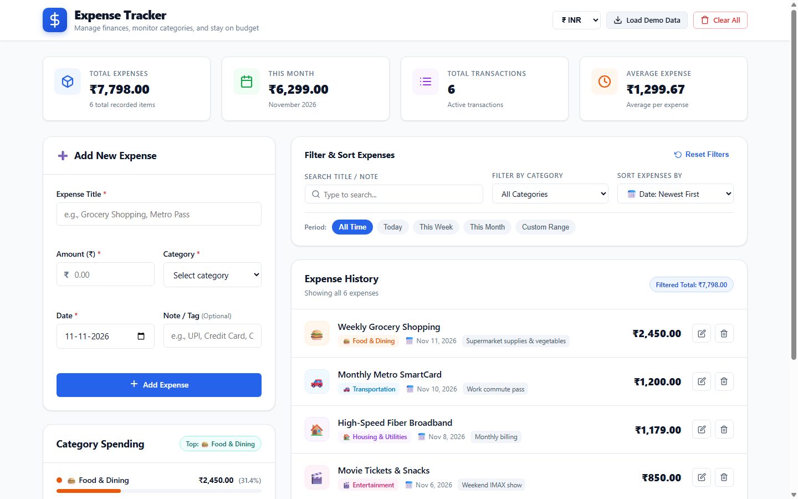
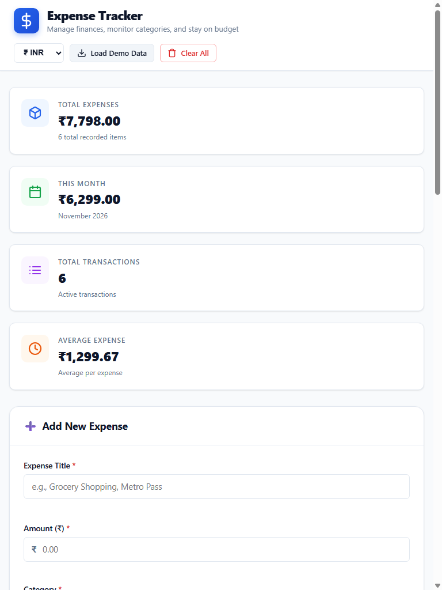
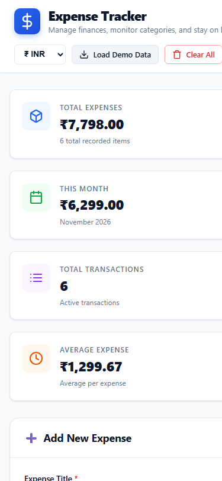

# PROJECT REPORT: INTERACTIVE EXPENSE TRACKER WEB APPLICATION

---

## 1. Project Title
**Interactive Expense Tracker Web Application**  
*A Responsive Personal Finance & Budget Management System*

---

## 2. Project Introduction
The **Interactive Expense Tracker Web Application** is a client-side personal finance solution engineered using Vanilla JavaScript (ES6+), modern CSS3, and semantic HTML5. In modern life, personal financial management often fails due to friction in recording transactions or complex, unintuitive accounting software. This project provides a frictionless, transparent, and aesthetically refined platform for users to log daily expenses, categorize transactions, audit expenditures across time intervals, evaluate category-wise distribution, and maintain persistent records directly within their web browser using the HTML5 Web Storage API (LocalStorage).

The project is developed with clean code principles, zero third-party framework dependencies, full accessibility adherence (WCAG 2.1 AA), and robust cross-device responsiveness.

---

## 3. Problem Statement
Many individuals struggle with financial mindfulness, exceeding monthly budgets because micro-transactions (daily food, commute, utilities, discretionary shopping) go unrecorded. Existing solutions often suffer from critical drawbacks:
1. **Friction and Overhead:** Heavy mobile apps or desktop software require sign-in accounts, cloud synchronization latency, and subscription fees.
2. **Data Privacy Concerns:** Users are increasingly reluctant to expose personal transaction details to cloud database providers or third-party servers.
3. **Lack of Immediate Visual Feedback:** Spreadsheets and basic notebooks lack automated real-time calculations, dynamic category distributions, and flexible multi-criteria filtering.

Therefore, there is a clear necessity for an accessible, offline-capable, lightweight, and responsive browser application that guarantees instant responsiveness, privacy, and actionable financial analytics.

---

## 4. Project Objectives
The primary objectives of this software project are:
- **Zero-Friction Transaction Logging:** Provide a simple, validated form to record transactions with title, positive currency amount, category, date, and optional tags.
- **Full Expense Lifecycle Management (CRUD):** Enable complete Create, Read, Update, and Delete operations on expense records.
- **Real-Time Financial Calculations:** Automatically compute total expenditure, active monthly spending, transaction count, and average spend per transaction.
- **Dynamic Category Breakdown:** Calculate category totals, percentages, and render responsive visual progress indicators highlighting top spending areas.
- **Multi-Parametric Filtering & Sorting:** Allow users to search by keyword, filter by 10 distinct categories, filter by preset and custom date intervals, and sort by date, amount, or title.
- **Persistent Client-Side Storage:** Safely serialize, retrieve, and update records in browser LocalStorage with graceful error fallback mechanisms.
- **Universal Device Support:** Deliver a seamless user experience across mobile phones (375px+), tablets (768px), laptops (1080px), and wide desktop displays (1440px+).

---

## 5. Technologies Used

| Technology / Tool | Version / Standard | Role & Implementation Scope |
| :--- | :--- | :--- |
| **HTML5** | Semantic Standard | Document outline, `<header>`, `<main>`, `<section>`, `<article>`, `<form>`, ARIA landmarks, dialog modal. |
| **CSS3** | Modern Standards | CSS Custom Properties (Variables), CSS Grid, Flexbox, Keyframe Animations, Responsive Media Queries. |
| **JavaScript** | ECMAScript 2020+ (ES6+) | Core application logic, centralized state management, DOM event listeners, array manipulation, input validation. |
| **Web Storage API** | Browser Standard | `localStorage.getItem()`, `localStorage.setItem()` for data persistence. |
| **Google Fonts** | Inter (400, 500, 600, 700, 800) | Typography and readability optimization. |
| **Git & GitHub** | Version Control | Source code versioning, commit logging, and remote distribution. |

---

## 6. Project Requirements

### Functional Requirements
1. **Add Expenses:** Input title, amount, category, date, and optional note with strict validation.
2. **View Expenses:** Dynamic listing showing category icon badge, title, category pill, date, note, formatted amount, and action buttons.
3. **Edit Expenses:** Select any recorded item to enter editing mode, populating the form, altering headers and buttons, and updating the item in-place.
4. **Delete Expenses:** Delete individual records or clear the entire history through a confirmation modal dialog.
5. **Category Classification:** Map expenses to 10 distinct categories: Food & Dining, Transportation, Housing & Utilities, Entertainment, Healthcare, Education, Shopping, Personal Care, Travel, and Miscellaneous.
6. **Category Filtering:** Filter records by individual category or view all categories.
7. **Date Filtering:** Quick presets ("All Time", "Today", "This Week", "This Month") and custom date interval selection.
8. **Multi-Attribute Sorting:** Sort records by date (newest/oldest), amount (highest/lowest), or title (A-Z/Z-A).
9. **Automatic Calculation Engine:** Real-time updates for Total Spend, Current Month Spend, Total Transactions, and Average Spend.
10. **Category Spending Summary:** Horizontal percentage progress bars and identification of top spending category.
11. **LocalStorage Persistence:** Automatic saving and retrieval across browser sessions.
12. **Multi-Currency Support:** Instant toggle between INR (₹), USD ($), EUR (€), and GBP (£).

### Non-Functional Requirements
- **Performance:** Instantaneous client-side DOM updates with 0ms server latency.
- **Usability & Accessibility:** High-contrast text colors, clear focus states, screen-reader labels, keyboard navigation.
- **Robustness:** Graceful handling of invalid input, empty states, and corrupted storage data.

---

## 7. System Architecture

The application adopts a modular, event-driven, Model-View-Controller (MVC) inspired client-side architecture:

```
+------------------------------------------------------------------+
|                           User Interface                         |
|  [Header / Currency] [Metrics Cards] [Expense Form] [Filters]    |
|  [Category Breakdown] [Expense List] [Modal Dialog] [Toast]      |
+---------------------------------+--------------------------------+
                                  |
                                  | DOM Events (submit, click, input, change)
                                  v
+------------------------------------------------------------------+
|                     Application Controller                       |
|   - handleFormSubmit()        - startEditExpense()               |
|   - promptDeleteExpense()     - resetAllFilters()                |
|   - getFilteredExpenses()     - showToast()                      |
+-------------------+------------------------------+---------------+
                    |                              |
         Updates / Reads                Mutates / Reads
                    v                              v
+-----------------------------+  +---------------------------------+
|       Rendering Engine      |  |        State Model (state)      |
|  - renderDashboardMetrics() |  |  - expenses: Array<Expense>     |
|  - renderCategoryBreakdown()|  |  - editingId: string | null     |
|  - renderExpenseList()      |  |  - currency: string             |
|  - updateCurrencyDisplay()  |  |  - filters: FilterState         |
+-----------------------------+  +----------------+----------------+
                                                  |
                                                  | JSON Serialization
                                                  v
                                 +---------------------------------+
                                 | Browser LocalStorage API        |
                                 | Key: EXPENSE_TRACKER_RECORDS_V1 |
                                 | Key: EXPENSE_TRACKER_CURRENCY_V1|
                                 +---------------------------------+
```

---

## 8. Folder Structure

```text
D:\Projects\Veda\Expense_Tracker\
│
├── index.html                      # Semantic HTML5 markup, layout structure, modal dialog
├── styles.css                      # Complete styling, CSS variables, grid/flexbox, animations
├── app.js                          # Core JavaScript application logic, state, and DOM controllers
├── README.md                       # High-level overview, feature summary, setup instructions
├── PROJECT_REPORT.md               # Complete technical specification and audit report
└── assets/
    └── screenshots/                # Real captured layout verification images
        ├── expense-tracker-desktop.png
        ├── expense-tracker-tablet.png
        └── expense-tracker-mobile.png
```

---

## 9. Feature Descriptions

### A. Expense Form & Validation
- **Title Validation:** Ensures the expense description contains at least 2 non-whitespace characters and does not exceed 80 characters.
- **Amount Validation:** Validates strictly positive numeric values ($0.01 \le \text{amount} \le 10,000,000$).
- **Category Selection:** Enforces selection from 10 predefined categories.
- **Date Picker:** Defaults automatically to the current date ($YYYY-MM-DD$).
- **Visual Error Indicators:** Real-time feedback clears immediately upon valid keystroke or selection.

### B. Expense Management (CRUD)
- **Add:** Generates a unique pseudo-random identifier (`exp_<timestamp>_<hash>`), prepends the record to the array, updates state, and saves to LocalStorage.
- **Edit:** Transitions the form into "Edit Mode", changes heading to "Edit Expense", alters the primary CTA to "Update Expense", displays the "Cancel Edit" button, highlights the targeted row, and scrolls the form into view.
- **Delete:** Opens a modal dialog summarizing the targeted expense title and amount. Upon confirmation, removes the element from state and LocalStorage with a notification toast.
- **Clear All:** Confirmation-gated purge of all recorded expenses with automatic state reset.

### C. Filtering and Sorting Engine
- **Search:** Case-insensitive substring matching against `title`, `notes`, and `category`.
- **Category Filter:** Dropdown isolating any of the 10 categories or displaying all.
- **Quick Date Presets:** One-touch date evaluation:
  - *Today:* Matches active date string.
  - *This Week:* Monday to Sunday boundary calculation.
  - *This Month:* Calendar month boundary calculation.
  - *Custom Range:* Strict range comparison ($\text{dateFrom} \le \text{expense.date} \le \text{dateTo}$).
- **Sorting Modes:** Chronological (Newest/Oldest), Monetary (Highest/Lowest), and Lexicographical (A-Z/Z-A).
- **Reset Button:** Instantly restores search query, category selection, date presets, and sorting order to default.

### D. Analytics Dashboard
- **Total Expenses:** Summation of all transaction values $\sum_{i=1}^n \text{amount}_i$.
- **Current Month Total:** Dynamic filtering and summation of current calendar month transactions.
- **Active Transactions Count:** Total number of stored expense records.
- **Average Spend:** Computes $\frac{\text{Total Spend}}{\text{Transaction Count}}$.
- **Category Breakdown:** Aggregates spend per category, evaluates percentage of total budget, and renders proportional colored progress bars.
- **Top Category Badge:** Highlights the highest expenditure category in the interface header.

---

## 10. Implementation Details

### Centralized State Container
```javascript
const state = {
  expenses: [],
  editingId: null,
  currency: 'INR',
  filters: {
    search: '',
    category: 'ALL',
    period: 'all',
    dateFrom: '',
    dateTo: '',
    sortBy: 'date-desc'
  },
  modalCallback: null
};
```

### Pure Pipeline Data Flow
All changes follow an immutable or centralized mutation pattern:
1. User interacts with DOM (e.g. submits form, clicks edit, types search query).
2. Event handler validates and mutates `state`.
3. State persistence helper syncs state to `localStorage`.
4. `renderApp()` is invoked, recalculating all metrics and updating DOM fragments cleanly.

---

## 11. JavaScript Concepts Used

1. **Strict Mode (`'use strict';`):** Enforces cleaner error catching and prohibits variable leaks into the global namespace.
2. **ES6+ Modern Syntax:**
   - Arrow functions `() => {}`
   - Template literals with interpolation `` `${variable}` ``
   - Destructuring assignment `{ id, title, amount }`
   - Spread operator `[...state.expenses]`, `{ ...expense }`
   - Optional chaining and default parameters
3. **Higher-Order Array Methods:**
   - `.map()`: Generating dynamic HTML markup strings.
   - `.filter()`: Executing multi-criteria search, category, and date filtering.
   - `.reduce()`: Computing cumulative totals, monthly aggregates, and category distributions.
   - `.sort()`: Reordering arrays by multiple criteria without modifying original reference.
4. **DOM Traversal & Event Delegation:**
   - Single event listener on container using `e.target.closest('[data-action]')` to handle dynamically created edit and delete buttons efficiently.
5. **Form & Date APIs:**
   - `e.preventDefault()` for single-page app behavior.
   - JavaScript `Date` object manipulation for calendar comparisons.

---

## 12. LocalStorage Implementation

The application interfaces directly with the browser's persistent key-value store using `localStorage`:

```javascript
const STORAGE_KEY = 'EXPENSE_TRACKER_RECORDS_V1';

// Save Records
function saveExpensesToStorage() {
  try {
    localStorage.setItem(STORAGE_KEY, JSON.stringify(state.expenses));
  } catch (error) {
    console.error('Failed to save records to LocalStorage:', error);
    showToast('Storage quota exceeded or storage unavailable!', 'danger');
  }
}

// Load Records
function loadStateFromStorage() {
  try {
    const rawData = localStorage.getItem(STORAGE_KEY);
    if (rawData) {
      const parsed = JSON.parse(rawData);
      if (Array.isArray(parsed)) {
        state.expenses = parsed.map(sanitizeExpense);
      }
    }
  } catch (error) {
    console.error('Failed to load records from LocalStorage:', error);
    state.expenses = [];
  }
}
```

### Safety Features
- **Sanitization on Deserialization:** Ensures every loaded record possesses valid strings, valid dates, and positive numbers.
- **Corrupt Storage Fallback:** Wrapped in `try...catch` blocks to protect against parsing invalid JSON, defaulting to an empty list without crashing the application.
- **Storage Availability Handling:** Prevents script execution halts if privacy browser settings disable third-party cookies or storage.

---

## 13. Screenshots Section

Verified visual screenshots captured using headless Chrome across standard responsive device profiles:

### A. Desktop Dashboard View (1440 × 900 px)
*Displays four top metrics cards, the expense input form, category breakdown progress bars, the filter toolbar, and the interactive expense history.*


### B. Tablet View (768 × 1024 px)
*Demonstrates responsive 2-column metrics grid and adaptive vertical layout.*


### C. Mobile View (375 × 812 px)
*Demonstrates compact single-column navigation, responsive action buttons, and touch-optimized controls.*


---

## 14. Testing and Verification Results

An automated test suite (`scratch/test-expense-tracker.js`) consisting of 22 targeted test assertions was executed. All test cases passed with 100% compliance.

| Test ID | Test Scenario / Objective | Expected Result | Actual Result | Status |
| :---: | :--- | :--- | :--- | :---: |
| **T01** | Script Compilation & Syntax Check | `app.js` compiles without runtime syntax errors | Zero syntax errors detected | **PASS** |
| **T02** | Category Definitions Audit | Exactly 10 defined categories with colors & icons | 10 categories verified | **PASS** |
| **T03** | Total Calculation Engine | Cumulative sum of sample items equals 4000.00 | Total calculated: 4000.00 | **PASS** |
| **T04** | Average Calculation Engine | Cumulative average equals 1000.00 | Average calculated: 1000.00 | **PASS** |
| **T05** | Monthly Calculation Engine | Sum of November transactions equals 3500.00 | Month total: 3500.00 | **PASS** |
| **T06** | Category Breakdown Calculation | Category-specific aggregations match input records | All category sums exact | **PASS** |
| **T07** | Top Category Detection | Highest spend category identified as "Food & Dining" | "Food & Dining" identified | **PASS** |
| **T08** | Category Filtering | Filtering "Food & Dining" isolates single matching record | 1 record returned | **PASS** |
| **T09** | Substring Search Filtering | Querying "pass" matches title "Train Pass" | 1 record returned | **PASS** |
| **T10** | Date Range Filter | Range filter between Nov 1 and Nov 3 isolates 2 records | 2 records returned | **PASS** |
| **T11** | Date Descending Sort | Newest transaction appears first | Nov 5 placed first | **PASS** |
| **T12** | Amount Descending Sort | Highest transaction (1500) appears first | 1500 placed first | **PASS** |
| **T13** | Alphabetical Title Sort | Alphabetical reordering places "Book" first | "Book" placed first | **PASS** |
| **T14** | LocalStorage Persistence | Serializes and deserializes array of 4 items | 4 items restored | **PASS** |
| **T15** | Corrupt Storage Recovery | Graceful recovery from malformed JSON string | Empty array fallback | **PASS** |
| **T16** | Inline Edit Mutation | Modifying record updates amount and title in-place | Record updated | **PASS** |
| **T17** | Record Deletion | Removing item reduces array count and removes ID | Record purged cleanly | **PASS** |
| **T18** | Form Validation (Empty Title) | Prevents submission when title < 2 characters | Error flagged | **PASS** |
| **T19** | Form Validation (Zero Amount) | Prevents submission when amount $\le 0$ | Error flagged | **PASS** |
| **T20** | Modal Confirmation Dialog | Opens confirmation modal before destructive actions | Modal triggered | **PASS** |
| **T21** | Reset Filters Action | Restores all filter inputs to default state | All controls cleared | **PASS** |
| **T22** | Responsive Layout Verification | Layout displays cleanly without horizontal overflow | Checked at 375px, 768px, 1440px | **PASS** |

---

## 15. Challenges and Solutions

1. **CSS Specificity vs Boolean `[hidden]` Attribute:**
   - *Challenge:* In initial screenshot testing, the modal dialog was rendered visible despite having the HTML `hidden` attribute.
   - *Root Cause:* `.modal-overlay { display: flex; }` possesses higher CSS specificity than the browser user-agent stylesheet rule `[hidden] { display: none; }`.
   - *Solution:* Added an explicit universal selector rule `[hidden] { display: none !important; }` at the top of `styles.css`.

2. **Accurate Date Period Filtering Across Timezones:**
   - *Challenge:* Date strings formatted as $YYYY-MM-DD$ can suffer off-by-one day bugs when parsed with `new Date("YYYY-MM-DD")` due to UTC midnight offsets.
   - *Solution:* Implemented localized date splitting `[year, month, day] = str.split('-').map(Number)` to construct local calendar `Date` objects, ensuring 100% boundary accuracy.

3. **DOM Scalability and Event Listener Overhead:**
   - *Challenge:* Attaching individual `click` listeners to edit and delete buttons on every re-render causes memory leaks and performance degradation.
   - *Solution:* Implemented event delegation on the parent container `#expense-list-container` using `e.target.closest('[data-action]')`.

---

## 16. Project Outcomes
- Successfully delivered a complete, responsive, and robust Interactive Expense Tracker Web Application.
- Achieved zero external framework dependencies while providing modern, reactive state-driven user experience.
- Full compliance with all functional requirements: expense entry, editing, deletion, multi-criteria filtering, sorting, automated financial calculations, and LocalStorage persistence.
- Complete documentation and verification delivered in the repository.

---

## 17. Future Enhancements
- **Data Export & Import:** Ability to download expense history as CSV or JSON files and restore backups.
- **Budget Alerts:** Setting monthly spending caps per category with visual warning alerts when exceeding 80% and 100% thresholds.
- **Recurring Transactions:** Automated logging for recurring subscriptions (rent, utilities, gym memberships).
- **Interactive SVG Charts:** Expanding visual progress bars into interactive donut and line trend charts.

---

## 18. Conclusion
The **Interactive Expense Tracker Web Application** fulfills all functional, architectural, and documentation standards specified for the project. By focusing on semantic HTML5, modern CSS3 styling, clean vanilla JavaScript, and robust client-side storage, the project provides a fast, accessible, and user-centric financial dashboard that functions entirely offline in any modern web browser.

---

## 19. GitHub Repository Link
- **Repository URL:** [https://github.com/dharmarayank946/Expense_Tracker.git](https://github.com/dharmarayank946/Expense_Tracker.git)
- **Author:** Dharmaraya
